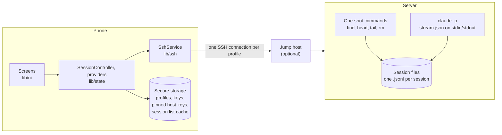
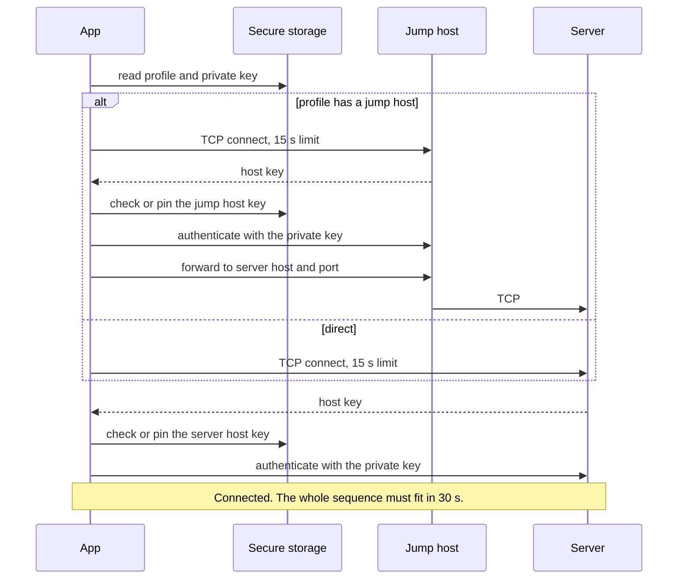
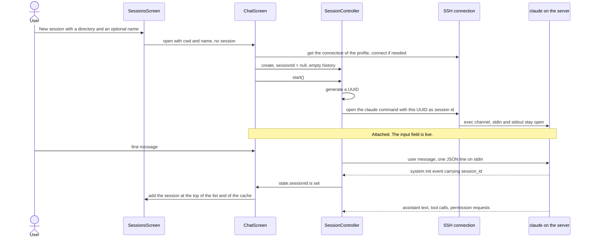
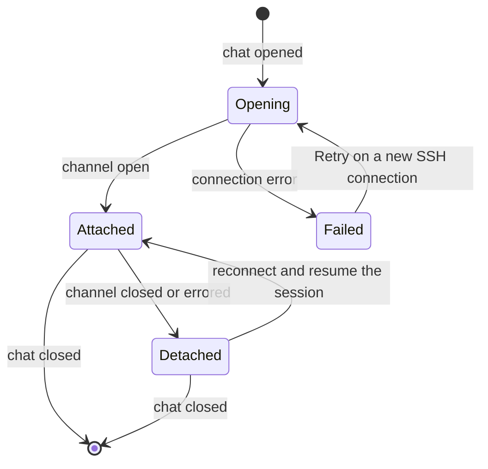
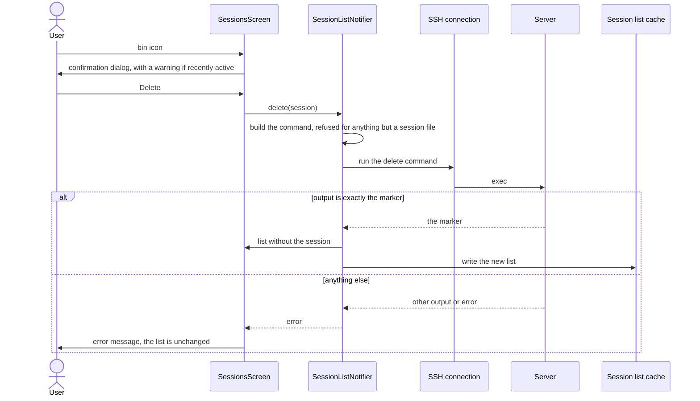

# claude-mobile

Flutter chat client for [Claude Code](https://claude.com/claude-code) sessions that live
on a server you reach over SSH. The app is not a terminal and not a claude.ai client: it
starts `claude -p` on the server, speaks stream-json with it over an SSH exec channel,
and draws the conversation.

Nothing is installed on the server besides Claude Code itself. Everything the app does
there is a plain shell command sent over SSH.

No secrets in git: SSH keys live only in the phone's secure storage.

- [The big picture](#the-big-picture)
- [The SSH connection](#the-ssh-connection)
- [Creating a session](#creating-a-session)
- [Resuming a session](#resuming-a-session)
- [When the link drops](#when-the-link-drops)
- [Deleting a session](#deleting-a-session)
- [Development](#development)

## The big picture

A **session** is a Claude Code conversation. On the server it is one file,
`~/.claude/projects/<project>/<session-id>.jsonl`, sometimes with a directory of the same
name next to it for what the session produced on the side. The app never keeps a
conversation on the phone: it only caches the list of sessions.

A **profile** is one server: host, port, user, an optional jump host, and a private key.



One SSH connection carries two kinds of traffic:

| Kind | `SshService` call | Used for |
| --- | --- | --- |
| One-shot command, runs to completion | `run(command)` | list sessions (`find`), read titles (`head`, `grep`), read history (`tail`), delete (`rm`), probe the link (`true`) |
| Long-lived exec channel, stdin and stdout kept open | `open(command)` | the `claude -p` process of the session on screen |

## The SSH connection

There is one live SSH connection per profile (`sshConnectionProvider`). It is opened when
the first screen needs it, shared by the sessions list and the chat, and closed when no
screen uses it any more.



What to know:

- **Trust on first use.** The first host key seen for a profile is pinned in the secure
  storage; any later connection must present the same one, otherwise it fails with
  `HostKeyMismatch`. The jump host has its own pin. Editing a profile's address or
  removing the profile forgets the pin.
- **Same key for both hops.** The profile's private key authenticates on the jump host
  and on the server.
- **Every wait is bounded** (`GuardedSsh`): 30 s to connect, 30 s for a one-shot
  command, 20 s to start `claude`. A link whose network is gone can look up for a long
  time; without a limit the app would wait on it for ever.
- **No automatic retry of a failed login.** A refused key retried in a loop looks like
  an attack to the server: the user presses *Retry* instead.

## Creating a session

From a profile's sessions list, *New session* asks for a directory on the server and an
optional name, then opens the chat. The session itself is created by `claude`, not by
the app: the app only chooses its id.



The command sent to the server (`SessionController.buildCommand`, wrapped in `_start`):

```bash
bash -lc 'cd <cwd> && claude -p \
  --input-format stream-json --output-format stream-json \
  --verbose --include-partial-messages --permission-prompt-tool stdio \
  --session-id <uuid> [--name <name>] [--model <alias>]'
```

- `bash -lc`: a bare SSH exec often lacks the `PATH` that holds `claude`; a login shell
  has it.
- `--session-id <uuid>`: the app generates the id, so it knows which session to resume
  if the link drops before `claude` has said anything.
- `--name`: only when a name was typed, and only at creation. A resumed session keeps
  the name it has.
- `--permission-prompt-tool stdio`: `claude` asks on stdout before using a tool and
  waits for the answer on stdin. The app shows a card; it never answers by itself.
- `--model`: only once a model was picked in the chat. Picking one re-attaches to the
  same session with the new flag.
- Every value is single-quoted for the shell (`shellQuote`).

The new session enters the list as soon as `claude` reports its id, before the app knows
where its file is. The path is looked up later, when it is needed (`findSessionCommand`),
and the list is read again from the server when the chat is closed.

Leaving the chat disposes the controller, which closes the exec channel. The session's
file stays on the server; the SSH connection stays open for the sessions list.

## Resuming a session

Tapping a session in the list attaches to it instead of creating one. The differences:

| | New session | Existing session |
| --- | --- | --- |
| Directory | typed by the user | `cwd` read from the session file |
| History on screen | empty | `tail -c 2000000 <file>`, parsed by `parseHistory` |
| Flag | `--session-id <new uuid>` | `--resume <id>` |
| Name | `--name` if given | unchanged |

The list itself comes from `find ~/.claude/projects -mindepth 2 -maxdepth 2 -name
'*.jsonl'`, newest first. Titles and directories are read for the 30 newest sessions
only, since each costs one remote command; older ones are read on demand when tapped.
The list is cached on the phone, shown at once, and replaced as soon as the server
answers.

A session written to less than a minute ago is marked as probably open elsewhere:
two `claude` processes writing to one session can split its history.

## When the link drops

The session outlives the link: its state is in the file on the server, so the app only
has to attach again with `--resume`.



- **On a drop**, the turn in progress is abandoned: running tools are shown as
  interrupted and a pending permission request is voided, never answered. A notice
  `Connection lost` is written in the conversation, after whatever `claude` printed on
  stderr.
- **Automatic retry** happens only when the SSH connection itself is down: up to
  5 attempts, after 1, 2, 4, 8 and 16 s. If SSH is still up, `claude` exited on its own
  and retrying would loop, so the app waits for the *Reconnect* button.
- **Back from the background**, the app probes the link with `true` (5 s limit), since
  a phone can lose the network while asleep without being told, and reconnects if the
  probe fails or the channel is gone.
- **Reconnecting** replaces the SSH connection first if it does not answer, then starts
  `claude --resume <id>` again. Overlapping attempts share one: two `--resume` on the
  same session would fork its history.

## Deleting a session

The bin icon on a session erases it **from the server**. There is no undo, hence the
confirmation, which adds a warning when the session was active in the last minute.



The command (`deleteSessionCommand` in `lib/core/session_listing.dart`):

```bash
rm -f -- '<dir>/<id>.jsonl' && rm -rf -- '<dir>/<id>' && echo claude-mobile:deleted
```

- **Two things are removed**: the session file, and the directory of the same name
  where Claude Code keeps what the session produced on the side.
- **Guard before `rm -rf`.** The command is only built for an absolute path of the form
  `.../.claude/projects/<project>/<id>.jsonl` with no `..` segment. Anything else throws
  before a single byte is sent.
- **Confirmed, not assumed.** The marker is echoed only if both `rm` succeeded. The
  session leaves the list and the cache only when the output is exactly the marker.
- **The list is not re-read**: the session is taken out of the list in memory and of the
  cache, so the deletion shows at once.
- **It does not stop a running `claude`.** A session open elsewhere keeps its process;
  the dialog warns, nothing more.
- A session created a moment ago, whose file is not known yet, cannot be deleted until
  the list has been refreshed from the server.

Deleting a **profile** is a different thing: it removes the profile, its key, its pinned
host keys and its cached list from the phone, and touches nothing on the server.

## Development

```bash
flutter pub get
flutter analyze
flutter test                 # unit and widget tests
flutter test test/live       # skipped unless LIVE_SSH_HOST is set
tool/live_rig/start.sh       # prints the variables for a local rig (fake_claude.py)
```

Code layout, branch rules and conventions are in [`CLAUDE.md`](CLAUDE.md). The original
design and the v1 plan are in [`docs/superpowers/`](docs/superpowers).
